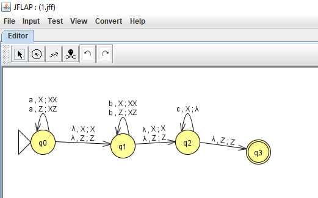
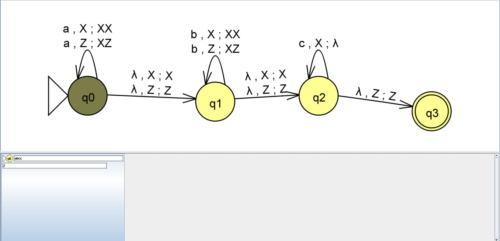
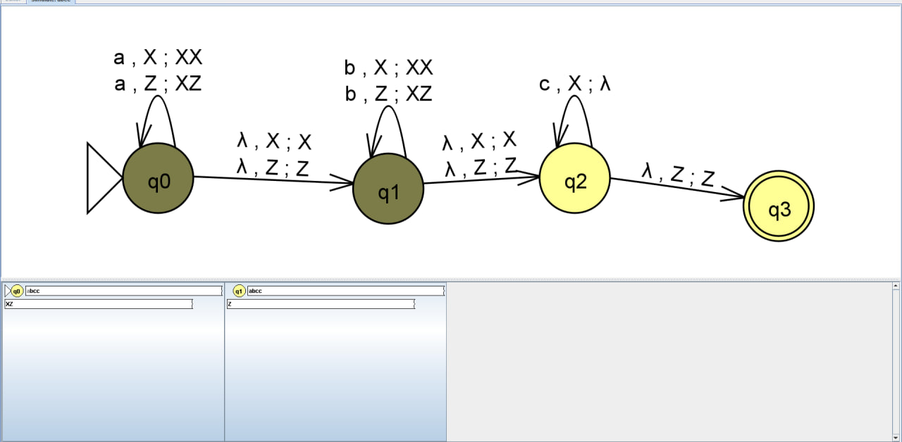
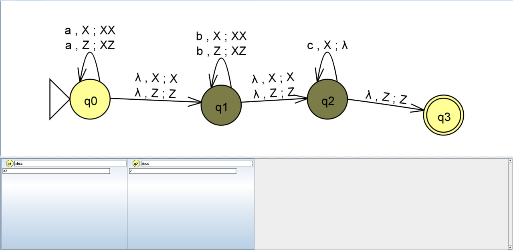
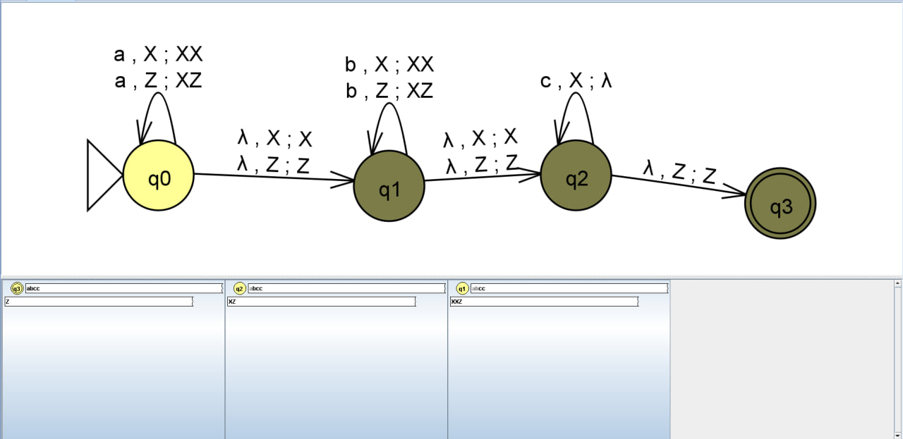
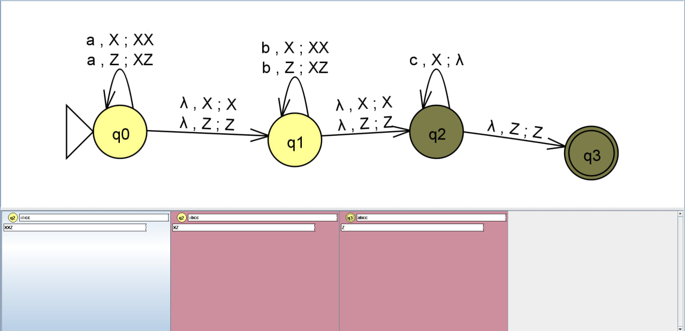
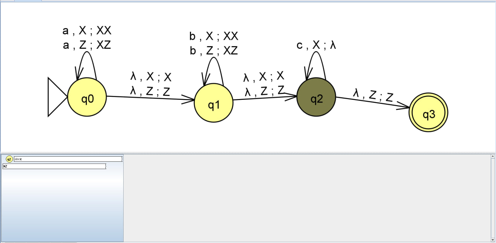
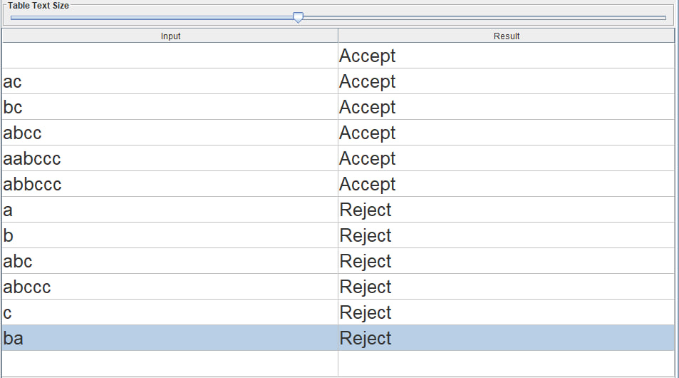
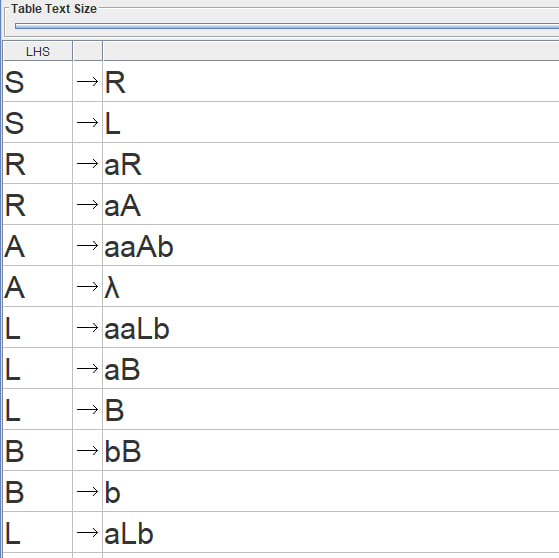
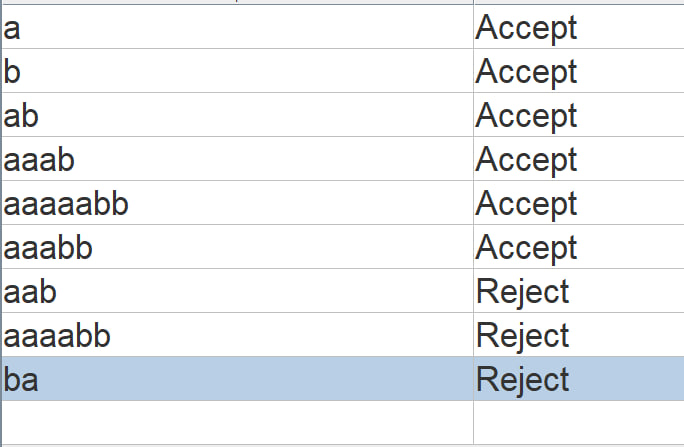

# Отчет по лабораторной работе №3
**Тема:** Автоматы с магазинной памятью, контекстно-свободные грамматики и свойства контекстно-свободных языков в среде JFLAP  
**Вариант:** 3  
**Выполнил:** Алиев Эльчин Алойсатович КИ24-17/1Б  

---

## 1. Цель работы

Исследование автоматов с магазинной памятью (МПА), контекстно-свободных грамматик (КСГ), приобретение практических навыков их проектирования и верификации в среде JFLAP, а также формальное доказательство принадлежности или непринадлежности языков к классу контекстно-свободных (КСЯ) с помощью леммы о разрастании.

---

## 2. Постановка задач

1. **Часть 1:** С использованием системы JFLAP построить автомат с магазинной памятью (МПА), предназначенный для распознавания языка $L_3 = \{a^n b^m c^{m+n} : n \ge 0, m \ge 0\}$. Указать критерий принятия цепочек, протестировать автомат на контрольном наборе данных и предоставить программную реализацию МПА.
2. **Часть 2:** С использованием системы JFLAP построить контекстно-свободную грамматику (КСГ), описывающую язык $L_{19} = \{a^n b^m : n \ne 2m, m \ge 0, n \ge 0\}$. Протестировать грамматику с помощью алгоритма перебора (Brute Force Parse).
3. **Часть 3:** Доказать формально контекстно-свободность либо ее отсутствие для языка Варианта 3:  
   $$L_{35} = \{w \in \{a, b, c\}^* : n_a(w) + n_b(w) = 2 n_c(w)\}$$

---

## 3. Структура файлов проекта

* `1-1.jff` — конфигурация автомата с магазинной памятью (МПА) для языка $L_3$ (Часть 1)
* `2-1.jff` — контекстно-свободная грамматика (КСГ) для языка $L_{19}$ (Часть 2)
* `photo/` — директория со скриншотами экспериментов и верификации в JFLAP

---

## 4. Часть 1. Автомат с магазинной памятью (МПА)

### 4.1. Логика работы автомата и критерий допуска

Язык $L_3 = \{a^n b^m c^{m+n} : n \ge 0, m \ge 0\}$ задает структуру, в которой за блоком символов $a$ следует блок символов $b$, а общее число последующих символов $c$ в точности равно сумме $n + m$.

* **Критерий принятия цепочек:** по заключительному (финальному) состоянию ($L(P)$).
* **Принцип работы магазина:**
  * До начала работы в магазине находится маркер дна $Z$.
  * Находясь в состоянии $q_0$, автомат считывает символы $a$ и помещает маркеры $X$ в стек поверх маркера $Z$.
  * По $\lambda$-переходу автомат переходит в состояние $q_1$, где считывает символы $b$ и также добавляет маркеры $X$ в стек. К концу входного блока $a^n b^m$ на стеке находится ровно $n + m$ маркеров $X$.
  * По $\lambda$-переходу управление переходит в $q_2$, где на каждый прочитанный символ $c$ со стека снимается ровно один маркер $X$.
  * При исчерпании входной строки и обнаружении на вершине стека маркера дна $Z$ автомат совершает переход в заключительное состояние $q_3$.

### 4.2. Граф переходов МПА

Формальное определение:  
$$P = (\{q_0, q_1, q_2, q_3\}, \{a, b, c\}, \{X, Z\}, \delta, q_0, Z, \{q_3\})$$

### 4.3. Пошаговое выполнение процесса распознавания (Step with State)

Пошаговая трассировка автомата в среде JFLAP на цепочке `abcc`:

### 4.4. Верификация МПА (Multiple Run)

Автомат протестирован в режиме **Input -> Multiple Run** на цепочках, принадлежащих и не принадлежащих языку:

## 5. Часть 2. Контекстно-свободная грамматика (КСГ)

### 5.1. Анализ языка и схема правил

Для языка $L_{19} = \{a^n b^m : n \ne 2m, m \ge 0, n \ge 0\}$ соотношение степеней распадается на два взаимоисключающих случая:

1. $n > 2m$ (избыток символов $a$): цепочка состоит из сбалансированной основы $a^{2k}b^k$ и как минимум одного дополнительного символа $a$ слева.
2. $n < 2m$ (недостаток символов $a$ / избыток $b$): цепочка формируется добавлением лишних символов $b$, либо неполных пар, где на один символ $b$ приходится строго меньше двух символов $a$.

Сформированная система правил КСГ:

* $S \to R \mid L$
* **Ветка $n > 2m$:**
* $R \to aR \mid aA$
* $A \to aaAb \mid \lambda$

* **Ветка $n < 2m$:**
* $L \to aaLb \mid aLb \mid aB \mid B$
* $B \to bB \mid b$

### 5.2. Тестирование КСГ (Multiple Brute Force Parse)

Тестирование выполнено через модуль **Input $\to$ Multiple Brute Force Parse**:

## 6. Часть 3. Исследование контекстно-свободности языка $L_{35}$

### 6.1. Формулировка задачи

Задан язык над алфавитом $\Sigma = \{a, b, c\}$:

$$L_{35} = \{w \in \{a, b, c\}^* : n_a(w) + n_b(w) = 2 n_c(w)\}$$

Требуется доказать принадлежность либо непринадлежность данного языка к классу контекстно-свободных языков (КСЯ).

### 6.2. Теоретическое доказательство контекстно-свободности

Язык $L_{35}$ **является контекстно-свободным**.

Для доказательства принадлежности языка к классу КСЯ достаточно построить детерминированный/недетерминированный автомат с магазинной памятью (МПА), распознающий его, либо предъявить контекстно-свободную грамматику (КСГ).

#### Доказательство через эквивалентность балансировочной задаче:

Перепишем характеристическое уравнение языка:

$$(n_a(w) + n_b(w)) - 2 n_c(w) = 0$$

Введем весовую функцию для каждого символа цепочки:

* $\text{weight}(a) = +1$
* $\text{weight}(b) = +1$
* $\text{weight}(c) = -2$

Тогда условие принадлежности цепочки $w \in L_{35}$ формулируется как:

$$\sum_{x \in w} \text{weight}(x) = 0$$

Поскольку автомат с магазинной памятью (МПА) имеет неограниченный стек, он может использовать магазинные символы как целочисленный счетчик текущей суммы весов:

1. Если текущий баланс неотрицателен, стек хранит маркеры положительного баланса $+1$ (символы $P$).
2. Если текущий баланс отрицателен, стек хранит маркеры отрицательного баланса $-1$ (символы $M$).
3. При поступлении символов $a$ или $b$:
* если на вершине стека маркер дна $Z$ или символ $P$, на стек помещается один символ $P$ (баланс увеличивается на 1);
* если на вершине стека символ $M$, верхний символ $M$ удаляется (баланс компенсируется на $+1$).

4. При поступлении символа $c$ (вес $-2$):
* если на вершине $P$ в количестве $\ge 2$, снимаются два символа $P$;
* если на вершине один $P$, он снимается и помещается один символ $M$ ($+1 - 2 = -1$);
* если на вершине маркер дна $Z$ или символ $M$, на стек добавляются два символа $M$.

5. В конце чтения цепочки магазин должен содержать исходный маркер дна $Z$ (что строго соответствует суммарному балансу $0$).

#### Построение контекстно-свободной грамматики для $L_{35}$:

Контекстно-свободный язык $L_{35}$ порождается грамматикой $G = (\{S\}, \{a, b, c\}, P, S)$, где символ $S$ генерирует нейтральные по балансу цепочки:

* $S \to \lambda$
* $S \to SS$
* $S \to aScSbS \mid aSbScS \mid bSaScS \mid bScSaS \mid cSaSbS \mid cSbSaS$
* $S \to aSaScS \mid aScSaS \mid cSaSaS$
* $S \to bSbScS \mid bScSbS \mid cSbSbS$

Каждое базовое правило вносит в цепочку ровно два символа веса $+1$ ($a$ или $b$) и ровно один символ веса $-2$ ($c$), взаимно компенсируя их в произвольном порядке следования символов.

**Вывод:** Поскольку для языка $L_{35}$ построен абстрактный МПА и эквивалентная КСГ, язык $L_{35}$ **принадлежит классу контекстно-свободных языков (является КСЯ)**.

---

## 7. Заключение

В ходе выполнения лабораторной работы исследованы принципы функционирования автоматов с магазинной памятью и механизмы порождения языков контекстно-свободными грамматиками. В среде JFLAP спроектирован МПА с допуском по финальному состоянию для языка со счетной структурой, верифицирована КСГ с ветвлением логики для неравенства степеней, а также аналитически доказана контекстно-свободность языка через сведение к задаче взвешенного магазинного баланса.
