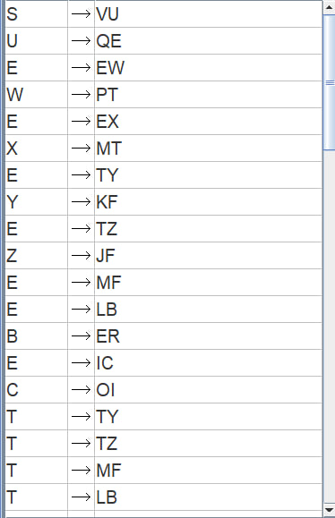
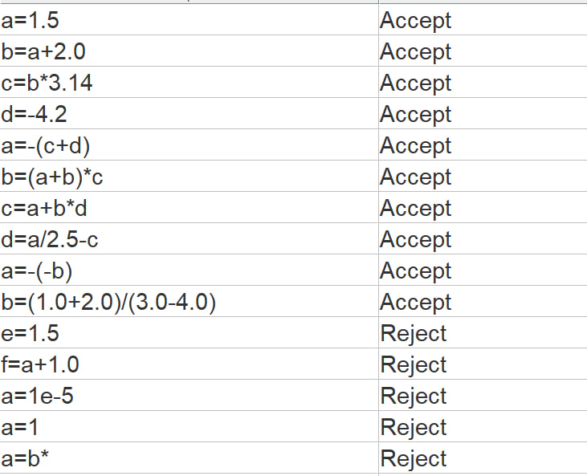

# Отчет по практической работе №4

**Тема:** Синтаксический анализ контекстно-свободных языков. Алгоритм Кока — Янгера — Касами (CYK)

**Вариант:** 4

**Выполнил:** Алиев Э. А. КИ24-17/1Б

**Проверил:** Мымликов В. Н.

---

## 1. Цель работы

Исследование свойств универсальных алгоритмов синтаксического анализа контекстно-свободных языков (КСЯ), практическое освоение методов приведения контекстно-свободных грамматик к нормальной форме Хомского (НФХ), проектирование грамматики оператора присваивания с арифметическими выражениями в среде JFLAP и ее верификация с помощью алгоритма Кока — Янгера — Касами (CYK).

---

## 2. Постановка задачи (Вариант 4)

С использованием системы JFLAP построить грамматику, определяющую заданный язык, для последующего синтаксического анализа методом Кока — Янгера — Касами:

* **Язык:** оператор присваивания, в правой части которого задано арифметическое выражение.

* **Элементы выражений:**
* Вещественные константы в обычном позиционном формате (экспоненциальная форма записи отсутствует, обязательны целая часть, разделительная точка и дробная часть, например: `1.5`, `2.0`, `3.14`);

* Имена переменных из одного символа: строго диапазон от `a` до `d`;

* Знаки операций и круглые скобки `(` и `)` для переопределения порядка вычисления подвыражений.

* **Приоритет операций (в сторону строгого убывания):**
1. Унарный минус (наивысший приоритет среди операций);

2. Мультипликативные операции (`*`, `/`);

3. Аддитивные операции (`+`, `-`);

4. Оператор присваивания (`=`).

---

## 3. Структура файлов проекта

* `1.jff` — модель грамматики в нормальной форме Хомского для среды JFLAP.
* `photo/1.jpg` — экранная форма таблицы правил грамматики в НФХ в редакторе JFLAP.
* `photo/2.jpg` — результаты распознавания контрольного набора тестовых цепочек методом CYK (Multiple Run).

---

## 4. Разработка контекстно-свободной грамматики

### 4.1. Исходная многоуровневая грамматика

Для обеспечения однозначности разбора и корректного отражения приоритетов операций грамматика разделена на стратифицированные синтаксические уровни (от низшего приоритета к высшему):

1. **Аксиома (оператор присваивания $S$):**

$$S \to V = E$$

2. **Аддитивный уровень ($E$):** бинарные операции сложения `+` и вычитания `-` (левоассоциативные):

$$E \to E + T \mid E - T \mid T$$

3. **Мультипликативный уровень ($T$):** бинарные операции умножения `*` и деления `/` (левоассоциативные):

$$T \to T * F \mid T / F \mid F$$

4. **Унарный уровень ($F$):** унарный минус имеет более высокий приоритет, чем умножение и деление, и связывается справа налево:

$$F \to - F \mid P$$

5. **Первичные выражения ($P$):** скобочные блоки, переменные и вещественные числа:

$$P \to ( E ) \mid V \mid N$$

6. **Вещественные константы ($N$):**

$$N \to I . I$$

$$I \to D I \mid D$$

7. **Терминальные классы:**

$$V \to a \mid b \mid c \mid d$$

$$D \to 0 \mid 1 \mid 2 \mid 3 \mid 4 \mid 5 \mid 6 \mid 7 \mid 8 \mid 9$$

---

## 5. Приведение к Нормальной Форме Хомского (НФХ)

Алгоритм Кока — Янгера — Касами работает исключительно с грамматиками, приведенными к НФХ. В НФХ правая часть каждого правила обязана состоять либо ровно из двух нетерминалов ($A \to BC$), либо ровно из одного терминала ($A \to a$).

### 5.1. Пошаговые этапы преобразования

1. **Устранение $\lambda$-правил:** грамматика изначально не порождает пустую цепочку $\lambda$, данный шаг выполнен тривиально.

2. **Исключение цепных правил (Unit Productions):**
* Раскрыта цепочка $E \to T \to F \to P$.

* Нетерминалы выражений ($E, T, F$) напрямую наследуют переменные $a, b, c, d$.

* Целые числа ($DI$ и одиночные цифры $0..9$) изолированы и **не добавлены** напрямую в $E, T, F$, что исключает ошибочный допуск целочисленных констант и гарантирует распознавание исключительно вещественных чисел с десятичной точкой ($N \to IC$, где $C \to OI$).

3. **Замена терминальных символов операций вспомогательными переменными:**
* $Q \to =$
* $P \to +$
* $M \to -$
* $K \to *$
* $J \to /$
* $L \to ($
* $R \to )$
* $O \to .$

4. **Бинаризация длинных правых частей:**
* $S \to VU, \quad U \to QE$
* $E \to EW, \quad W \to PT$ (сложение)
* $E \to EX, \quad X \to MT$ (бинарное вычитание)
* $E \to TY \mid TZ, \quad T \to TY \mid TZ, \quad Y \to KF, \quad Z \to JF$ (мультипликативный уровень)
* $E \to MF, \quad T \to MF, \quad F \to MF$ (унарный минус)
* $E \to LB \mid IC, \quad T \to LB \mid IC, \quad F \to LB \mid IC, \quad B \to ER, \quad C \to OI$ (скобки и вещественные константы)

### 5.2. Реализация грамматики в JFLAP

Грамматика сохранена в файле `1.jff` и загружена в JFLAP.

---

## 6. Алгоритм Кока — Янгера — Касами (CYK) и верификация

### 6.1. Математический базис алгоритма

Алгоритм CYK реализует восходящий синтаксический анализ (снизу вверх) с использованием динамического программирования[cite: 17, 32, 45].
Для цепочки длины $n$ формируется треугольная таблица синтаксического анализа (ТСА) $T$:

1. **Нижняя строка (база, подстроки длины 1):**

$$t_{i, 1} = \{A \mid A \to a_i \in P\}$$

2. **Заполнение уровней (подстроки длины $j$ от 2 до $n$):**

$$t_{i, j} = \{A \mid A \to BC \in P, \; \exists k \, (1 \le k < j): B \in t_{i, k}, \; C \in t_{i+k, j-k}\}$$

3. **Критерий допуска:** цепочка принимается тогда и только тогда, когда в верхней ячейке $t_{1, n}$ содержится начальный нетерминал грамматики ($S \in t_{1, n}$).

---

### 6.2. Результаты тестирования (JFLAP Multiple CYK Parse)

Проверка выполнена в среде JFLAP через модуль **Input $\to$ Multiple Run / CYK Parse** на контрольном наборе из 15 цепочек.

### 6.3. Анализ контрольного набора тестовых цепочек

---

## 7. Заключение

В ходе выполнения практической работы исследованы принципы восходящего синтаксического анализа и функционирование алгоритма Кока — Янгера — Касами (CYK)[cite: 8, 17, 32]. Исходная контекстно-свободная грамматика оператора присваивания с приоритетом операций была формализована и преобразована в эквивалентную нормальную форму Хомского (НФХ) с полным сохранением языка[cite: 11, 32].

Спроектированная в среде JFLAP модель `1.jff` успешно прошла верификацию: распознаватель безошибочно принимает корректные синтаксические конструкции с вещественными константами и скобками, а также отсекает целочисленные формы, запрещенные переменные и некорректные выражения, полностью удовлетворяя всем требованиям Варианта 4[cite: 8, 11, 99].