# Отчет по практической работе №5

**Тема:** Исследование контекстно-свободных грамматик и алгоритмов синтаксического анализа (LL(1) и SLR(1))

**Вариант:** 5

**Выполнил:** Алиев Э.А. КИ24-17/1Б

**Проверил:** Мымликов В.Н.

---

## 1. Цель работы

Исследование контекстно-свободных грамматик и алгоритмов детерминированного синтаксического анализа: построение и исследование предиктивного LL(1)-анализатора в среде JFLAP, программная реализация синтаксического анализатора методом рекурсивного спуска на языке Python с доказательством принадлежности грамматики к классу LL(1), а также построение канонического набора $LR(0)$-ситуаций и таблицы SLR(1)-анализа в среде JFLAP.

---

## 2. Постановка задач (Вариант 5)

1. **Часть 1 (LL(1)-грамматика в JFLAP):**
Построить LL(1)-грамматику для языка оператора присваивания, в правой части которого задано арифметическое выражение.

* Элементы: вещественные константы **только в экспоненциальной форме** (обычный формат отсутствует), переменные из одного символа (от `a` до `d`), знаки операций и круглые скобки.

* Приоритеты операций (в сторону строгого убывания): унарный минус $\to$ мультипликативные (`*`, `/`) $\to$ аддитивные (`+`, `-`) $\to$ присваивание (`=`).

* Требование: грамматика не должна повторять SLR(1)-грамматику из Части 3.

2. **Часть 2 (Рекурсивный спуск):**
Предложить программную реализацию метода рекурсивного спуска для языка **последовательностей выражений** с разделителем `;`.

* Элементы: вещественные константы только в экспоненциальной форме, целочисленные константы в десятичной системе счисления, имена переменных из 1–2 символов, знаки операций и скобки. Приоритеты операций аналогичны Части 1.

* Требование: представить формальное доказательство принадлежности грамматики к классу LL(1) и протестировать не менее 10 цепочек с выводом сообщений `Accepted` или `Rejected`.

3. **Часть 3 (SLR(1)-грамматика в JFLAP):**
Построить SLR(1)-грамматику, описывающую язык **последовательностей операторов присваивания** с разделителем `;`.

* В качестве L-значения оператора выступает только имя переменной (от `a` до `d`). В правой части — арифметическое выражение с константами только в экспоненциальной форме.

* Требование: грамматика строится с левой рекурсией, не повторяет LL(1)-грамматику Части 1 и не имеет SLR(1)-конфликтов.

---

## 3. Структура файлов проекта

* `1.jff` — модель предиктивной LL(1)-грамматики для JFLAP (Часть 1).

* `2.py` — исходный код лексического и синтаксического анализатора методом рекурсивного спуска (Часть 2).

* `3.jff` — модель леворекурсивной SLR(1)-грамматики для JFLAP (Часть 3).

* `photo/` — каталог скриншотов работы анализаторов и результатов верификации.

---

## 4. Часть 1. Построение и верификация LL(1)-грамматики

### 4.1. Преобразования грамматики к виду LL(1)

Для исключения недетерминизма и конфликтов в таблице синтаксического анализа из грамматики устранена левая рекурсия путем введения хвостовых нетерминалов $A, B, K$, а также выполнена левая факторизация правил:

* Аксиома: $S \to V = E$

* Аддитивный уровень: $E \to T A, \quad A \to + T A \mid - T A \mid \lambda$

* Мультипликативный уровень: $T \to U B, \quad B \to * U B \mid / U B \mid \lambda$

* Унарный минус (наивысший операторный приоритет): $U \to - U \mid P$

* Первичные выражения: $P \to ( E ) \mid V \mid N$

* Экспоненциальная вещественная константа: $N \to I . I e H$

* Порядок экспоненты со знаком или без: $H \to + I \mid - I \mid I$

* Целая и дробная части (цепочка цифр): $I \to D K, \quad K \to D K \mid \lambda$

* Переменные диапазона `a`–`d`: $V \to a \mid b \mid c \mid d$

* Цифры: $D \to 0 \mid 1 \mid 2 \dots \mid 9$

### 4.2. Множества FIRST и FOLLOW

| Нетерминал $X$ | $\text{FIRST}(X)$ | $\text{FOLLOW}(X)$ |
|:---|:---|:---|
| $S$ | $\{a, b, c, d\}$ | $\{\$\}$ |
| $E$ | $\{-, (, a, b, c, d, 0..9\}$ | $\{), \$\}$ |
| $A$ | $\{+, -, \lambda\}$ | $\{), \$\}$ |
| $T$ | $\{-, (, a, b, c, d, 0..9\}$ | $\{+, -, ), \$\}$ |
| $B$ | $\{*, /, \lambda\}$ | $\{+, -, ), \$\}$ |
| $U$ | $\{-, (, a, b, c, d, 0..9\}$ | $\{*, /, +, -, ), \$\}$ |
| $P$ | $\{(, a, b, c, d, 0..9\}$ | $\{*, /, +, -, ), \$\}$ |
| $N$ | $\{0..9\}$ | $\{*, /, +, -, ), \$\}$ |
| $H$ | $\{+, -, 0..9\}$ | $\{*, /, +, -, ), \$\}$ |
| $I$ | $\{0..9\}$ | $\{., e, *, /, +, -, ), \$\}$ |
| $K$ | $\{0..9, \lambda\}$ | $\{., e, *, /, +, -, ), \$\}$ |
| $V$ | $\{a, b, c, d\}$ | $\{=, *, /, +, -, ), \$\}$ |
| $D$ | $\{0..9\}$ | $\{0..9, ., e, *, /, +, -, ), \$\}$ |

### 4.3. Таблица синтаксического анализа LL(1)

Сформированная средой JFLAP предиктивная таблица $M[A, a]$ не содержит множественных записей, что подтверждает принадлежность грамматики к классу LL(1):

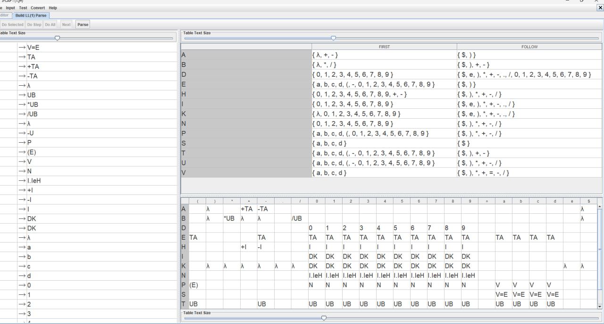

### 4.4. Трассировка разбора цепочки в JFLAP

При проверке цепочки `a=1.5e2` анализатор последовательно разворачивает стек по предиктивной таблице и завершает разбор с вердиктом `String successfully parsed!`:

**Результаты тестирования контрольного набора (не менее 6 примеров):**

1. Базовое присваивание экспоненциальной константы
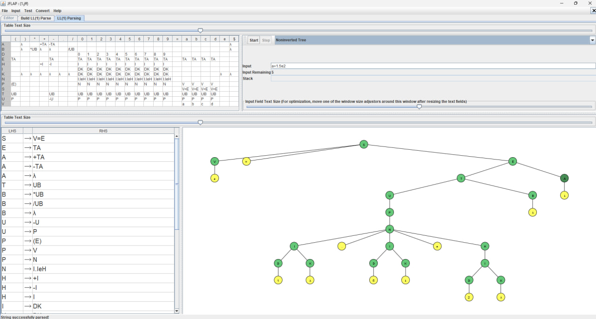

2. Унарный минус перед операндом, отрицательный порядок экспоненты
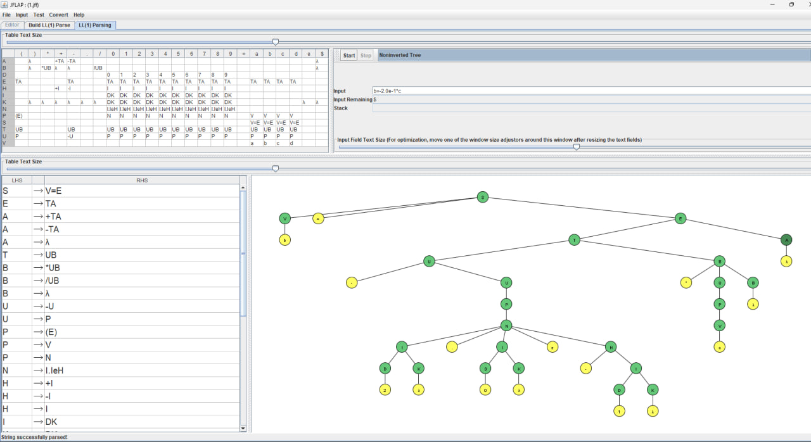

3. Унарный минус перед скобками, деление на порядок со знаком `+`
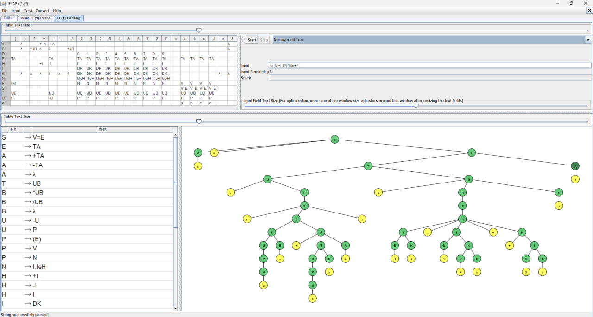

4. Скобочная группировка операндов
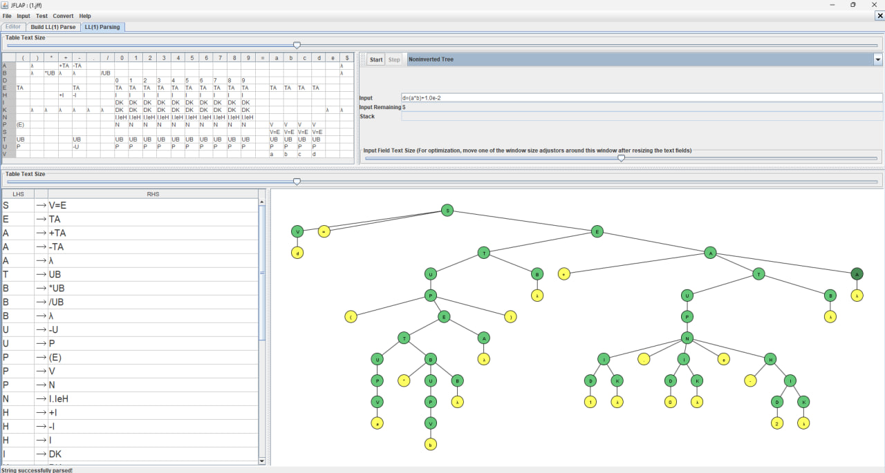

5. Обычный формат вещественного числа без `e` запрещен
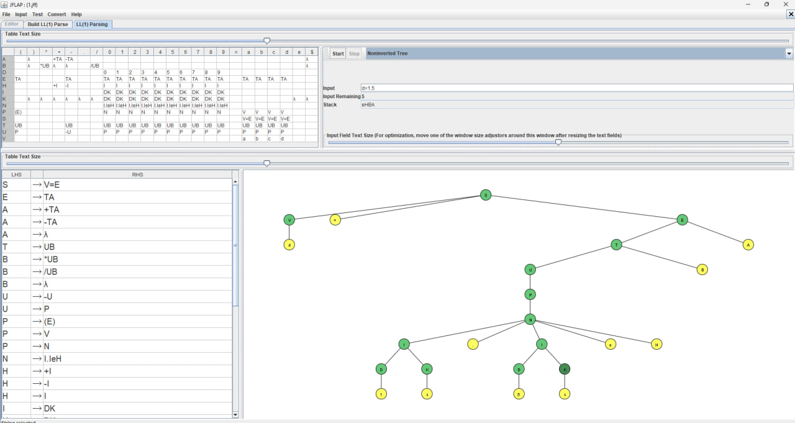

6. Переменная `e` выходит за пределы диапазона `a`–`d`
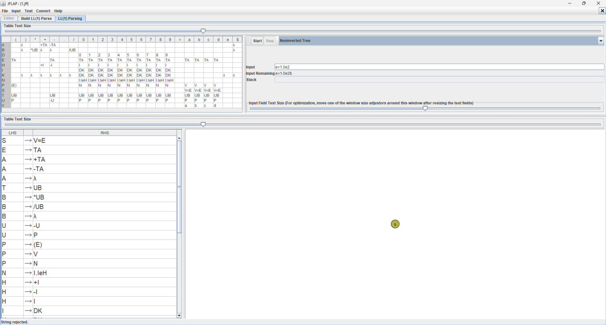

7. Целочисленные константы запрещены условием Части 1
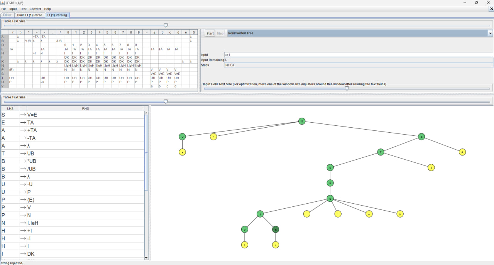

---

## 5. Часть 2. Метод рекурсивного спуска

### 5.1. Формальное доказательство принадлежности грамматики к классу LL(1)

**Определение критерия:** Грамматика $G$ принадлежит классу LL(1) тогда и только тогда, когда для каждого правила вывода с альтернативами $A \to \alpha_1 \mid \alpha_2 \mid \dots \mid \alpha_n$ выполняются условия:

1. Множества первых символов попарно не пересекаются: $\text{FIRST}(\alpha_i) \cap \text{FIRST}(\alpha_j) = \emptyset$ при $i \ne j$.
2. Если альтернатива $\alpha_i \Rightarrow^* \lambda$, то для всех остальных альтернатив $\text{FIRST}(\alpha_j) \cap \text{FOLLOW}(A) = \emptyset$.

**Доказательство по структурным нетерминалам:**

* **$Seq \to Expr \; Tail, \quad Tail \to ; Expr \; Tail \mid \lambda$:**
$\text{FIRST}(; \dots) = \{;\}$, $\text{FOLLOW}(Tail) = \{\$\}$. Так как $\{;\} \cap \{\$\} = \emptyset$, условие детерминированного завершения последовательности строго соблюдается.
* **$AddTail \to + Term \; AddTail \mid - Term \; AddTail \mid \lambda$:**
$\text{FIRST}(+) = \{+\}$, $\text{FIRST}(-) = \{-\}$, $\text{FOLLOW}(AddTail) = \{), ;, \$\}$. Пересечения между $\text{FIRST}$ пусты, а их объединение не пересекается с $\text{FOLLOW}$.
* **$MulTail \to * Factor \; MulTail \mid / Factor \; MulTail \mid \lambda$:**
$\text{FIRST}(*) = \{*\}$, $\text{FIRST}(/) = \{/\}$, $\text{FOLLOW}(MulTail) = \{+, -, ), ;, \$\}$. Условия 1 и 2 выполнены.
* **$Factor \to - Factor \mid Primary$:**
$\text{FIRST}(- Factor) = \{-\}$, $\text{FIRST}(Primary) = \{(, \mathbf{VAR}, \mathbf{INT}, \mathbf{FLOAT}\}$. Множества не пересекаются, выбор ветви унарного минуса однозначен.
* **Разрешение префикса переменной ($Expr \to \mathbf{VAR} = Expr \mid AddExpr$):**
При появлении токена переменной лексер выполняет предпросмотр ровно на 1 токен вперед: если следующий символ `=`, однозначно выбирается присваивание, в противном случае выполняется переход к обычному выражению.

Следовательно, грамматика является строго **LL(1)-грамматикой**.

### 5.2. Программная реализация и тестирование

Программа реализована на языке Python (`2.py`) без внешних библиотек.

**Результаты прогона контрольного набора из 10 цепочек:**

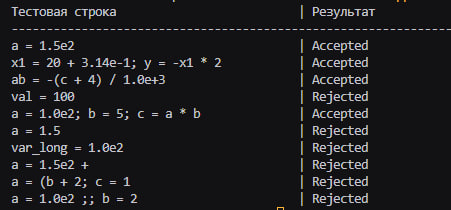

---

## 6. Часть 3. Построение и верификация SLR(1)-грамматики

### 6.1. Построение леворекурсивной грамматики

В соответствии с заданием Части 3 грамматика описывает последовательность операторов присваивания с разделителем `;` и использует естественную левую рекурсию:

* $S \to S ; A \mid A$ (леворекурсивный список присваиваний)

* $A \to V = E$ (L-значение строго переменная $V$)

* $E \to E + T \mid E - T \mid T$ (левоассоциативные аддитивные операции)
* $T \to T * U \mid T / U \mid U$ (левоассоциативные мультипликативные операции)
* $U \to - U \mid P$ (унарный минус с наивысшим приоритетом)
* $P \to ( E ) \mid V \mid N$

* $N \to I . I e H, \quad H \to + I \mid - I \mid I$
* $I \to I D \mid D$

* $V \to a \mid b \mid c \mid d$
* $D \to 0 \mid 1 \dots \mid 9$

### 6.2. Канонический набор LR(0)-ситуаций и таблица SLR(1)

В среде JFLAP через **Build SLR(1) Parse** построен канонический $LR(0)$-автомат. Анализатор строит функции ACTION и GOTO на основе множеств $\text{FOLLOW}$:

* Конфликты «перенос-свертка» между аддитивными и мультипликативными операциями разрешаются благодаря тому, что при наличии основы $E \to E + T \bullet$ символ `*` вызывает перенос в состояние накопления терма $T \to T * \bullet U$, обеспечивая приоритет умножения над сложением.
* Знак `=` вызывает перенос только в контексте L-значения $A \to V \bullet = E$, так как в выражениях за переменной $V$ могут следовать только $\{*, /, +, -, ), ;, \$\}$.

Таблица синтаксического анализа полностью заполнена и **не содержит конфликтов**.

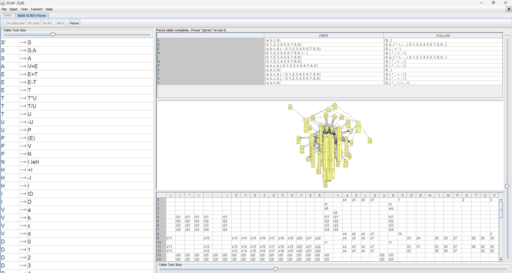

### 6.3. Результаты верификации в SLR(1) Parsing

Проверка тестовых последовательностей в модуле восходящего анализа подтвердила корректность модели:

1. Одиночный оператор присваивания с экспоненциальной константой
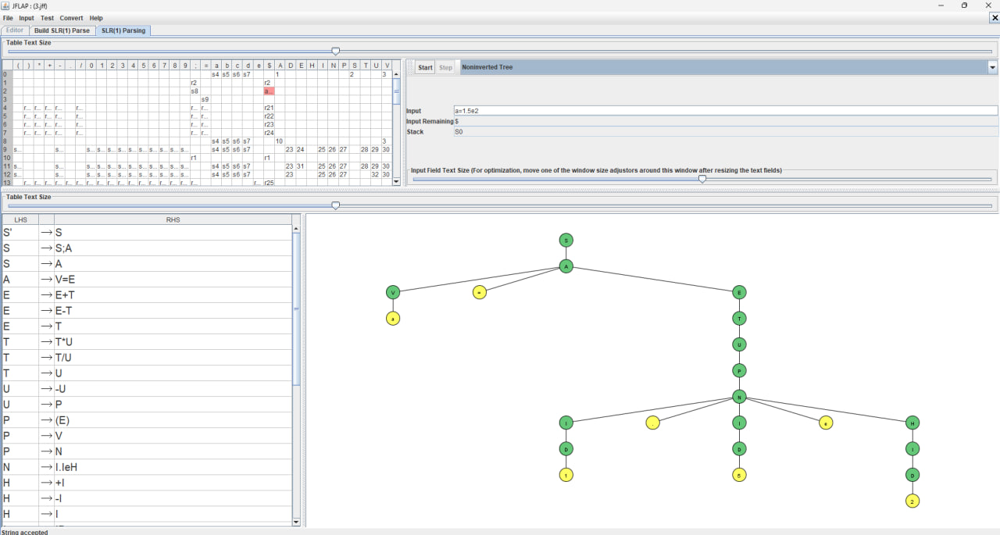

2. Последовательность двух операторов
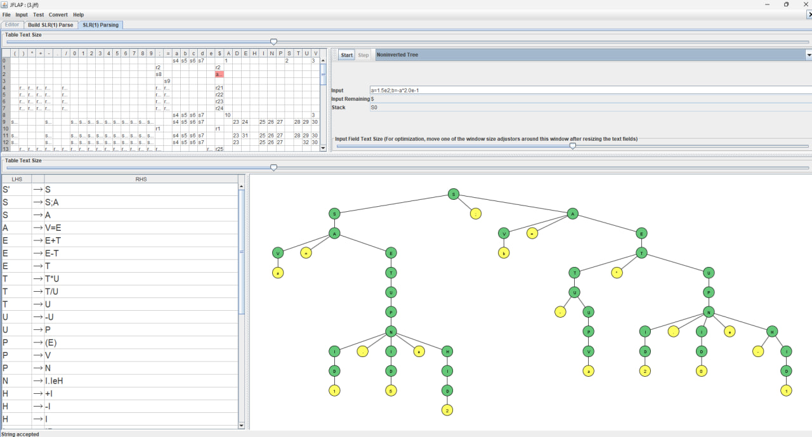

3. Сложное выражение с унарным минусом и вложенными скобками
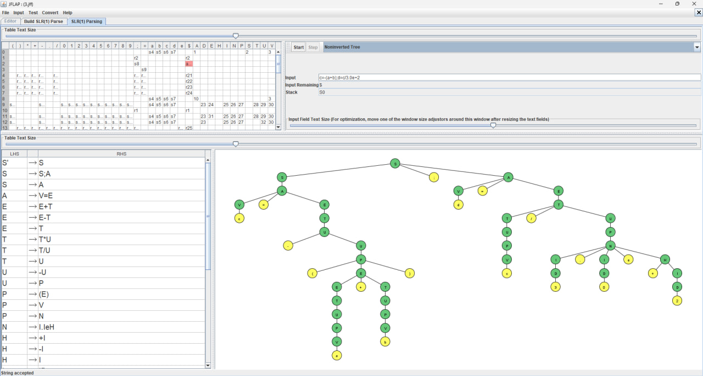

4. Число без экспоненты
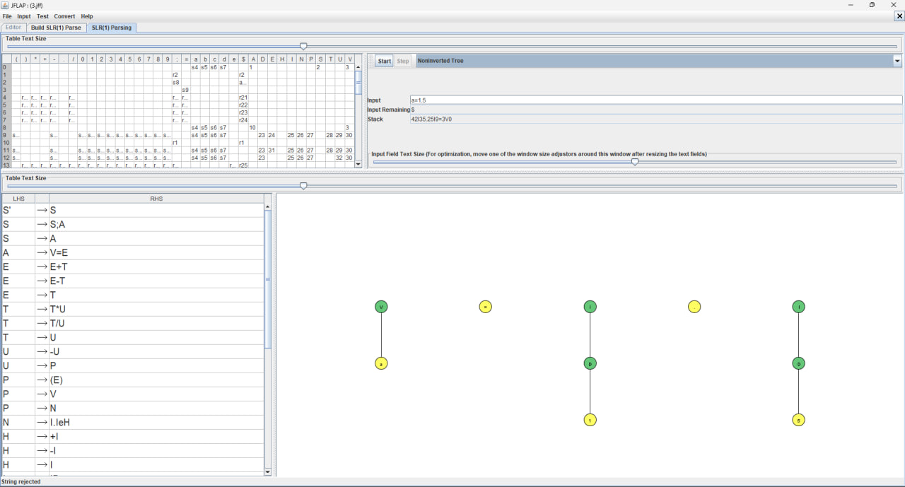

5. Целые числа в Части 3 запрещены
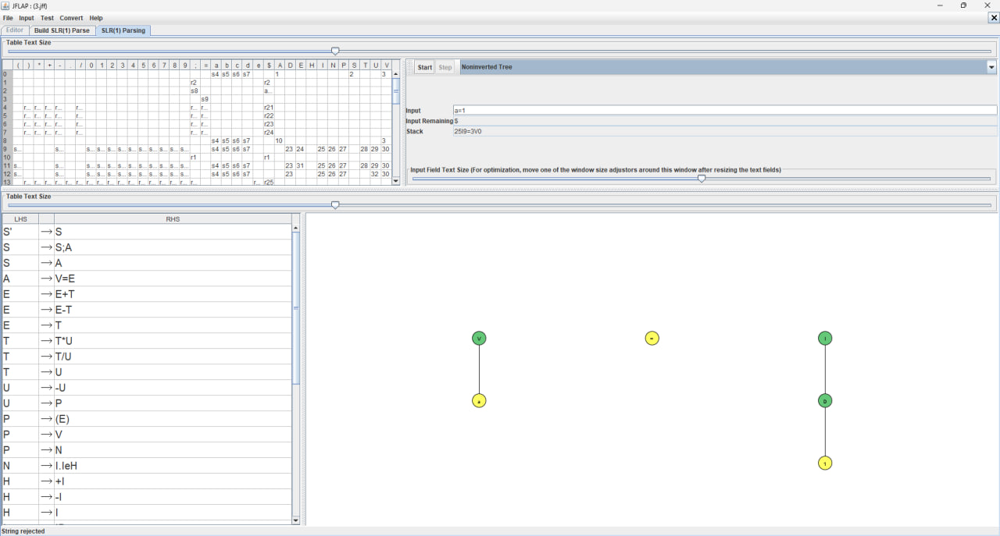

6. L-значение не является переменной
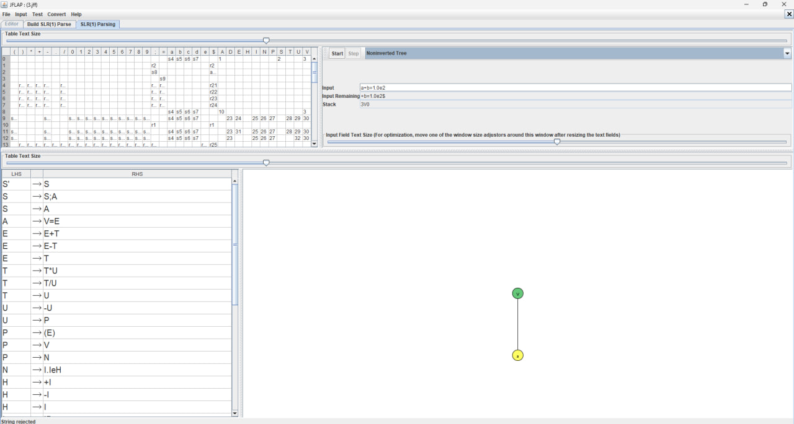

---

## 7. Заключение

В процессе выполнения практической работы исследованы алгоритмы синтаксического анализа контекстно-свободных языков сверху вниз (нисходящие: предиктивный LL(1) и рекурсивный спуск) и снизу вверх (восходящие: SLR(1)).

Для языка Варианта 5 построена и верифицирована правофакторизованная грамматика без левой рекурсии в формате LL(1), а также леворекурсивная грамматика в формате SLR(1). Анализатор методом рекурсивного спуска на языке Python продемонстрировал корректное распознавание цепочек выражений, отсекая лексические и синтаксические нарушения. Практические результаты полностью подтвердили теоретические критерии построения однозначных таблиц синтаксического анализа.