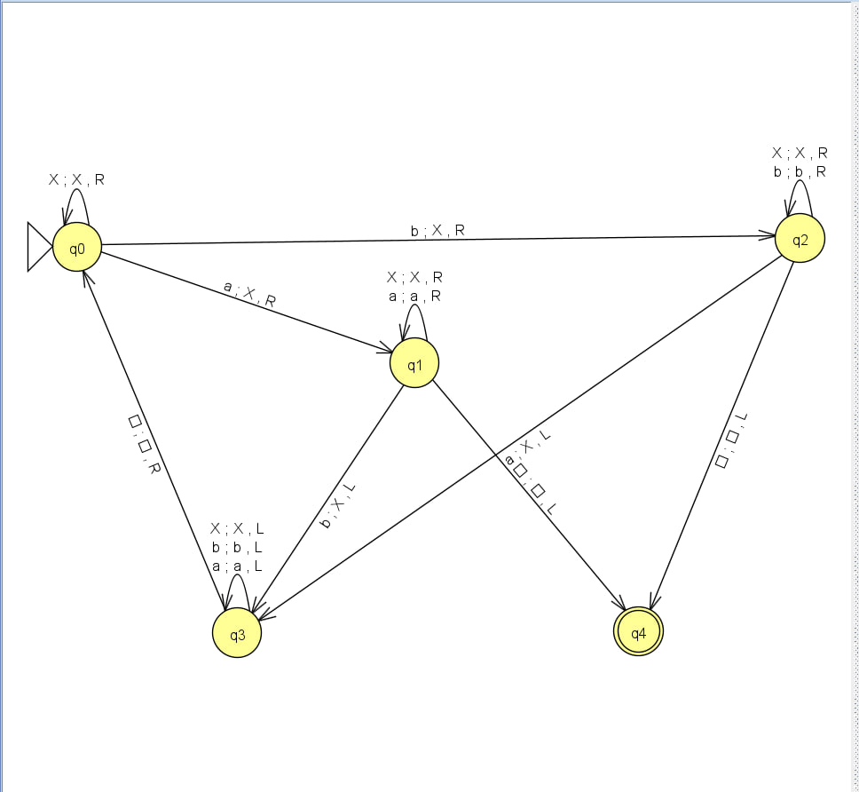
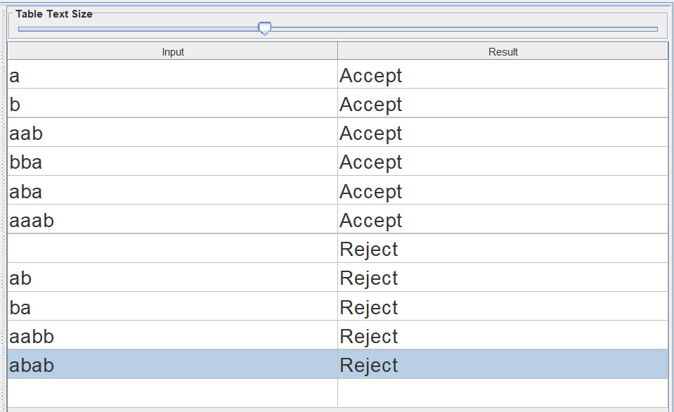
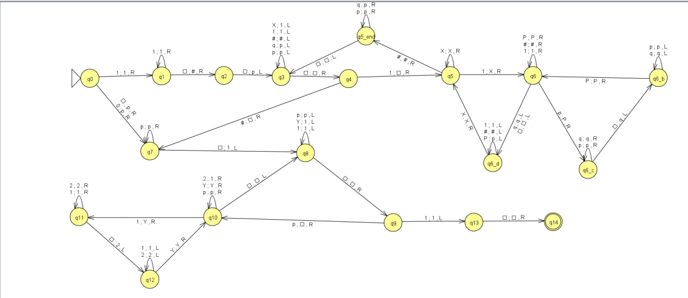
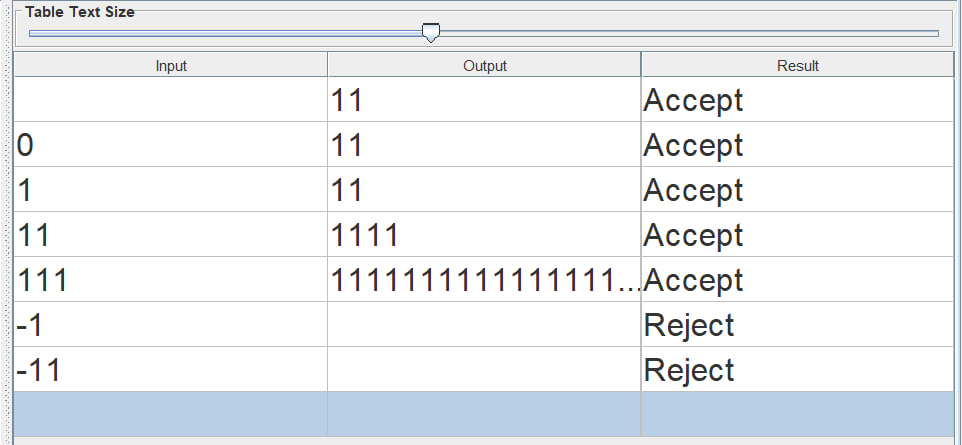

# Отчет по практической работе №6

**Тема:** Исследование свойств универсальных вычислительных машин на примере абстрактной машины Тьюринга

**Вариант:** 6

**Выполнил:** Алиев Э.А. КИ24-17/1Б

**Проверил:** Мымликов В.Н.

---

## 1. Цель работы

Исследование свойств универсальных вычислительных машин на примере абстрактной машины Тьюринга (МТ), приобретение практических навыков проектирования в среде JFLAP машин Тьюринга в качестве распознавателей формальных языков и преобразователей (вычислителей целочисленных функций в унарной системе счисления).

---

## 2. Постановка задач (Вариант 6)

1. **Часть 1 (МТ-распознаватель):**  
   С использованием системы JFLAP построить машину Тьюринга для распознавания языка над входным алфавитом $\Sigma = \{a, b\}$:
   $$L = \{w \in \{a, b\}^* : n_a(w) \ne n_b(w)\}$$
   Привести примеры функционирования созданной машины (не менее шести тестовых цепочек).

2. **Часть 2 (МТ-вычислитель):**  
   С использованием системы JFLAP построить машину Тьюринга для вычисления функции над целыми числами в унарной системе счисления:
   $$f(x) = 2^{x!}, \quad x \ge 0$$
   Обязательно предложить представление неположительных чисел в унарной системе счисления. Основание двойки задается неявно в логике переходов автомата. Привести примеры вычисления функции для разных аргументов (не менее шести примеров).

---

## 3. Структура файлов проекта

* `1.jff` — модель стандартной машины Тьюринга для распознавания языка $L = \{w : n_a(w) \ne n_b(w)\}$ (Часть 1).
* `2.jff` — модель стандартной машины Тьюринга для вычисления функции $f(x) = 2^{x!}$ (Часть 2).
* `photo/` — каталог со скриншотами графов переходов и результатов тестирования в JFLAP.

---

## 4. Часть 1. Машина Тьюринга — распознаватель языка

### 4.1. Формальное описание и алгоритм работы

Стандартная одноленточная машина Тьюринга задается семеркой компонентов:
$$M_1 = (Q, \Sigma, \Gamma, \delta, q_0, \Box, F)$$

где:
* $Q = \{q_0, q_1, q_2, q_3, q_4\}$ — конечное множество состояний управляющего устройства;
* $\Sigma = \{a, b\}$ — входной алфавит;
* $\Gamma = \{a, b, X, \Box\}$ — ленточный алфавит ($\Box$ — пустой символ, $X$ — маркер вычеркнутого символа);
* $q_0$ — начальное состояние;
* $F = \{q_4\}$ — множество заключительных (допускающих) состояний.

**Логика работы алгоритма (метод попарного взаимного погашения символов):**
1. **Поиск первого невычеркнутого символа ($q_0$):** головка движется вправо, пропуская маркеры `X`.
   * Если считан символ `a`, он заменяется на `X`, и управление переходит в состояние $q_1$ (поиск парного символа `b`).
   * Если считан символ `b`, он заменяется на `X`, и управление переходит в состояние $q_2$ (поиск парного символа `a`).
   * Если достигнут пустой символ $\Box$, значит все символы строки без остатка разбились на пары ($n_a(w) = n_b(w)$). Переход по $\Box$ в состоянии $q_0$ не определен, машина останавливается в недопускающем состоянии (`Reject`).
2. **Поиск пары `b` для вычеркнутого `a` ($q_1$):** головка идет вправо через `a` и `X`.
   * При нахождении `b` он заменяется на `X`, и совершается переход в $q_3$ (возврат к левому краю).
   * Если встретился пустой символ $\Box$, парного символа `b` в строке нет ($n_a(w) > n_b(w) \implies n_a(w) \ne n_b(w)$). Машина переходит в допускающее состояние $q_4$ (`Accept`).
3. **Поиск пары `a` для вычеркнутого `b` ($q_2$):** головка идет вправо через `b` и `X`.
   * При нахождении `a` он заменяется на `X`, и совершается переход в $q_3$.
   * Если встретился пустой символ $\Box$, парного символа `a` в строке нет ($n_b(w) > n_a(w) \implies n_a(w) \ne n_b(w)$). Машина переходит в допускающее состояние $q_4$ (`Accept`).
4. **Возврат головки ($q_3$):** головка смещается влево по символам `a`, `b`, `X` до левого граничного пробела $\Box$, делает шаг вправо и возвращается в состояние $q_0$ для следующей итерации.

### 4.2. Таблица функции переходов $\delta(q, \gamma)$

| Текущее состояние | Обозреваемый символ `a` | Обозреваемый символ `b` | Обозреваемый символ `X` | Пустой символ $\Box$ |
| :---: | :---: | :---: | :---: | :---: |
| $\to q_0$ | $(q_1, X, R)$ | $(q_2, X, R)$ | $(q_0, X, R)$ | — (`Reject`) |
| $q_1$ | $(q_1, a, R)$ | $(q_3, X, L)$ | $(q_1, X, R)$ | $(q_4, \Box, L)$ |
| $q_2$ | $(q_3, X, L)$ | $(q_2, b, R)$ | $(q_2, X, R)$ | $(q_4, \Box, L)$ |
| $q_3$ | $(q_3, a, L)$ | $(q_3, b, L)$ | $(q_3, X, L)$ | $(q_0, \Box, R)$ |
| $*q_4$ | — | — | — | — (`Accept`) |

### 4.3. Граф переходов и верификация в JFLAP

Граф переходов построенной МТ-распознавателя (`1.jff`):

Результаты тестирования на контрольном наборе из 11 цепочек в режиме **Multiple Run**:

---

## 5. Часть 2. Машина Тьюринга — вычислитель функции $f(x) = 2^{x!}$

### 5.1. Представление целых (в том числе неположительных) чисел в унарной системе

В соответствии с требованиями задания введена следующая схема унарного кодирования аргументов и значений:
1. **Положительные целые числа ($x > 0$):** кодируются последовательностью из $x$ единиц $w(x) = 1^x$ (например: $1 \to$ `1`, $2 \to$ `11`, $3 \to$ `111`).
2. **Нулевое значение ($x = 0$):** кодируется специальным символом `0` (также поддерживается подача пустой ленты $\lambda$). Поскольку $0! = 1$, значением функции при $x = 0$ является $f(0) = 2^{0!} = 2^1 = 2$ (на ленте формируется результат `11`).
3. **Отрицательные целые числа ($x < 0$):** кодируются префиксным знаком `-` перед унарной последовательностью единиц: $-1^{|x|}$ (например: $-1 \to$ `-1`, $-2 \to$ `-11`). Так как по условию варианта функция определена для $x \ge 0$, при чтении знака `-` в начальном состоянии $q_0$ переходы отсутствуют, и машина штатно отклоняет вход (`Reject`).
4. **Запись основания степени (`2`):** реализована **неявно** в алгоритме переходов через операцию удвоения выходного блока единиц.

### 5.2. Описание алгоритма вычисления

Работа машины Тьюринга $M_2$ разделена на две последовательные фазы:

* **Фаза 1 — Вычисление факториала $y = x!$ (состояния $q_0 \dots q_6$):**
  1. Если на входе `0` или пустой символ $\Box$ ($x = 0$), на ленту сразу записывается один маркер степени `p` ($0! = 1$), и автомат переходит ко второй фазе ($q_7$).
  2. Если на входе $1^x$ ($x \ge 1$), справа от единиц ставится разделитель `#` и один начальный символ аккумулятора факториала `p` (конфигурация $1^x\text{\#p}$).
  3. Во внешнем цикле по шагам $k = x, x-1, \dots, 1$ крайняя левая единица перед `#` стирается (остается $k-1$ единиц). Для каждой из оставшихся $k-1$ единиц текущее количество символов `p` дублируется в правую часть ленты временными символами `q`. По завершении прохода все символы `q` переименовываются обратно в `p`, что увеличивает аккумулятор ровно в $k$ раз.
  4. Когда все единицы слева от `#` исчерпаны, разделитель `#` стирается, и на ленте остается ровно $y = x!$ символов `p`.

* **Фаза 2 — Возведение в степень $2^y$ (состояния $q_7 \dots q_{14}$):**
  1. Справа от цепочки из $y = x!$ символов `p` записывается одна единица `1` (начальное значение $2^0 = 1$).
  2. В цикле сопоставления крайний левый символ `p` стирается, а каждая существующая единица `1` справа временно заменяется на `Y` с дописыванием в конец ленты символа `2`. Затем все `Y` и `2` переводятся в `1`, благодаря чему количество единиц на каждой итерации строго **удваивается**.
  3. Когда все символы `p` стерты, на ленте остается только результирующий блок из $2^{x!}$ единиц `1`. Головка позиционируется на крайнюю левую единицу результата, и автомат останавливается в допускающем состоянии $q_{14}$.

### 5.3. Граф переходов и верификация в JFLAP

Граф переходов построенной МТ-вычислителя (`2.jff`):

Результаты вычисления функции для различных аргументов в режиме **Multiple Runs**:

## 6. Заключение

В ходе выполнения практической работы исследованы вычислительные возможности стандартной машины Тьюринга в качестве распознавателя формальных языков и преобразователя данных. В среде JFLAP спроектирована и верифицирована МТ-распознаватель для языка цепочек с неравным количеством символов $a$ и $b$, а также многофазная МТ-вычислитель суперэкспоненциальной функции $f(x) = 2^{x!}$ в унарной системе счисления. Результаты пакетного и пошагового тестирования полностью подтвердили корректность разработанных автоматных моделей на всей области определения, включая граничные и неположительные значения аргументов.